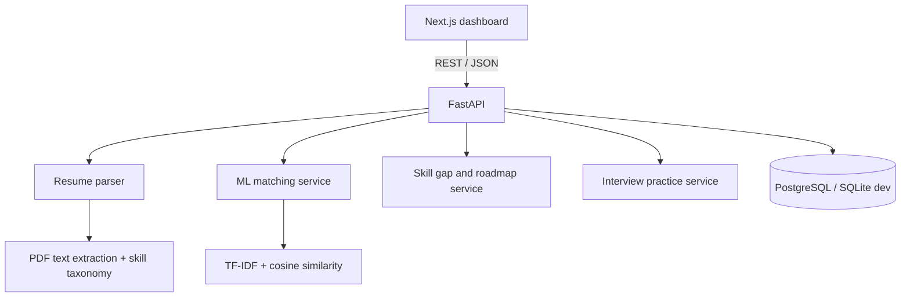

# Architecture

The current starter uses transparent, lightweight algorithms. LLM calls are not required for the core ML flow. Before production, add authenticated user identity, per-user row ownership, migrations, private object storage, rate limits, and monitored deployment.
